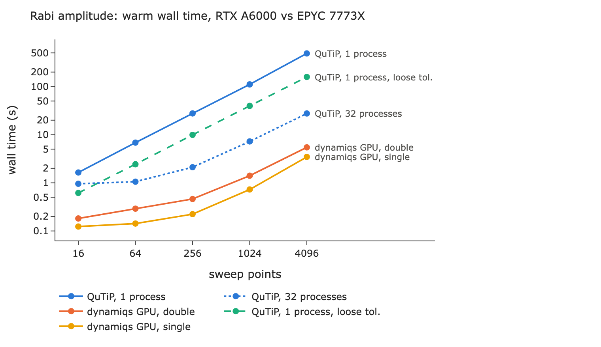
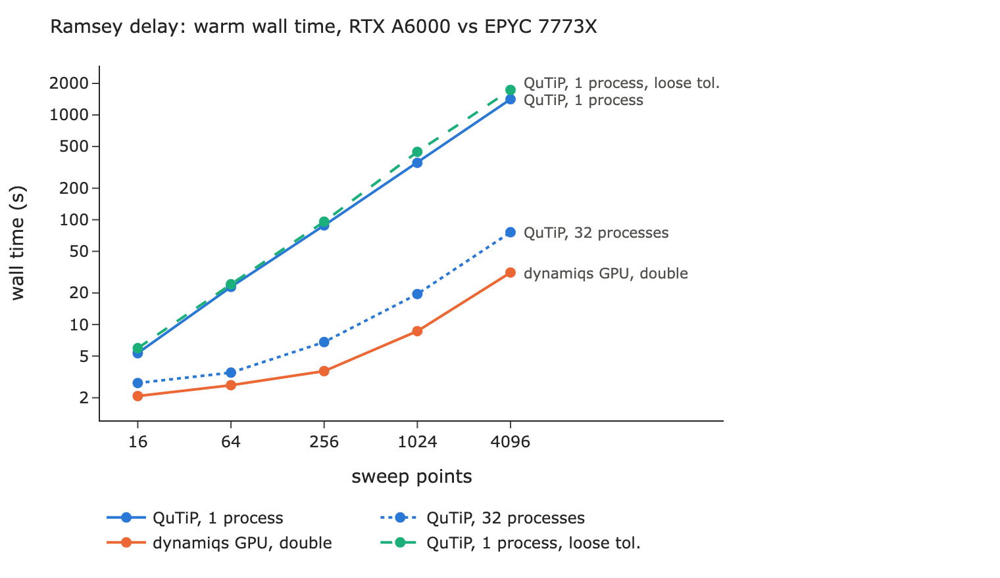
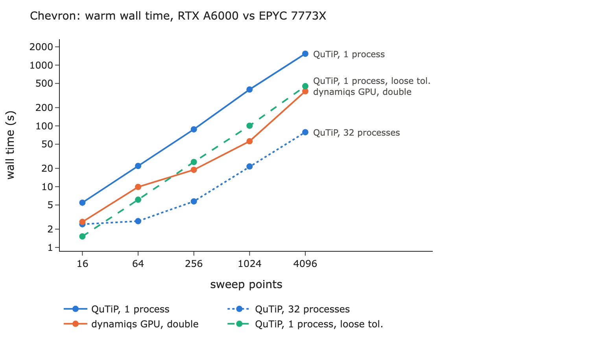

# dynamiqs on GPU versus QuTiP

Wall-time comparison of the two simulator backends on the sweeps of the
[performance notebook](../../notebooks/performance.py): Rabi amplitude, Ramsey
delay, and chevron (drive frequency × pulse duration), all on the two-qutrit
example platform. The platform is coupled and dissipative (T1, T2), so every
solve uses a 9 × 9 density matrix.

## Setup

| | |
| --- | --- |
| GPU runs | NVIDIA RTX A6000 (48 GB), JAX 0.12 with CUDA 12, dynamiqs 0.3.7 |
| CPU runs | 2 × AMD EPYC 7773X (64 cores each), QuTiP 5.3 |
| Software | Python 3.12, this branch, `OMP_NUM_THREADS=1` |
| Sizes | 16, 64, 256, 1024, and 4096 sweep points (chevron: 4², 8², …, 64²) |

The GPU and the serial QuTiP runs used separate nodes with the same CPU model.
QuTiP ran without access to any GPU. The 32-process QuTiP run is an extra
reference, not part of the like-for-like comparison: it shared its node with a
GPU run.

Both backends used the same tolerances, `Settings()` (`rtol=1e-7`, `atol=1e-9`)
for double precision. For single precision, both used the looser
`Settings(rtol=1e-5, atol=1e-6)` that float32 needs, so the QuTiP column next to
it uses the same tolerances while still computing in double precision.

Times are **warm** calls: the median of repeated calls after a first one, which
compiles the dynamiqs solvers for each new batch shape (the "first" columns).

## Results

The full table is in [results.md](results.md). [results.zip](results.zip)
holds the raw timings (`*.json`) and the averaged excited populations of every
sweep (`*.npz`), one pair per run.

Speedup of dynamiqs on the GPU over QuTiP in one process, double precision:

| Points | Rabi amplitude | Ramsey delay | Chevron |
| ---: | ---: | ---: | ---: |
| 16 | 9.0× | 2.6× | 2.1× |
| 64 | 23.6× | 8.7× | 2.2× |
| 256 | 59.9× | 24.6× | 4.6× |
| 1024 | 78.9× | 40.4× | 7.1× |
| 4096 | **89.4×** (488 s → 5.5 s) | **45.1×** (1412 s → 31 s) | **4.1×** (1540 s → 371 s) |





The backends agree within 1.1e-5 in double precision (at most 4e-6 except for
the largest chevrons), and within 5.5e-4 in single precision, consistent with
the tolerances.

## Considerations

- **The GPU pays off for large, homogeneous sweeps.** QuTiP's time grows
  linearly with the points, while one batched GPU solve costs nearly the same
  for 16 or 1024 points. Rabi amplitude, where every point shares the pulse
  shape, reaches 89× at 4096 points and still beats 32 QuTiP processes by 5×.
- **Ramsey** combines one batch per pulse segment with exactly exponentiated
  idle delays. It reaches 45×, and 2.4× over 32 QuTiP processes.
- **Chevron scales worst.** Every pulse duration is a separate batch, because
  the adaptive solver shares sample boundaries across a batch. Moreover,
  `batch_size=1024` cuts the sweep in order, and duration is the inner sweep
  axis: at 4096 points the GPU solves 256 batches of 16 frequencies instead of
  64 batches of 64. Here, 32 QuTiP processes are 4.7× faster than the GPU.
  Grouping by duration before splitting into batches should recover most of
  the batching; until then, a larger `batch_size` helps.
- **Compilation** costs 5–10 s for the first call of each new shape (up to 86 s
  for chevrons with many durations). Shapes are padded to powers of two, so
  repeated calibrations and nearby sizes reuse the compiled solvers.
- **Small sweeps** (16 points) gain at most a few times, and only once
  compiled: below about 100 points per batch the GPU is underused.
- **Single precision** made Rabi another 1.6× faster on the GPU, but the looser
  tolerances it needs also make QuTiP about 3× faster, so the like-for-like
  speedup is lower (46× at 4096 points). On this GPU, double precision is the
  better default.
- **Known issue:** the single-precision run stopped at the first Ramsey sweep.
  float32 rounding made an intermediate density matrix slightly non-Hermitian,
  which dynamiqs rejects when starting the next segment. The engine should
  re-symmetrize the state between segments.

## Reproducing

From the repository root, with the `dynamiqs` extra, the `notebooks` group, and
a CUDA build of JAX on the GPU machine (`jax-cuda12-plugin[with-cuda]` matching
the installed `jax`):

```sh
mkdir -p benchmarks/dynamiqs/results && cd benchmarks/dynamiqs/results
# On the GPU machine
python ../bench.py --backend dynamiqs --out dynamiqs-double
python ../bench.py --backend dynamiqs --precision single --out dynamiqs-single
# On a CPU machine of comparable model, without GPU access
python ../bench.py --backend qutip --repeats 1 --out qutip-double
python ../bench.py --backend qutip --precision single --repeats 1 --out qutip-single
python ../bench.py --backend qutip --workers 32 --repeats 1 --out qutip-double-32
# Anywhere, with kaleido installed for the charts
zip -9 ../results.zip *.json *.npz
python ../analyze.py
```

Set `OMP_NUM_THREADS=1` for the QuTiP runs. The serial QuTiP runs take about
two hours each at these sizes.
